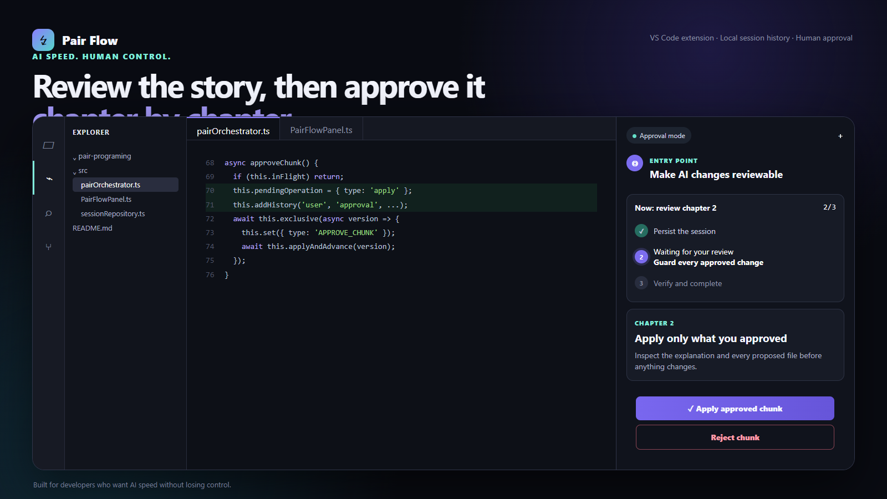
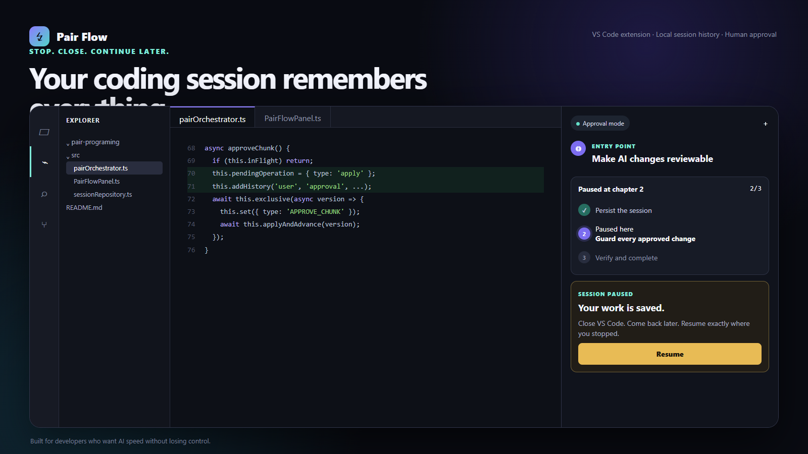

<div align="center">

# Pair Flow

### AI that cannot code faster than you can understand.

[](https://github.com/roee030/pair-programming-with-ai/actions/workflows/ci.yml)
[](https://github.com/roee030/pair-programming-with-ai/releases)
[](LICENSE)
[](https://code.visualstudio.com/)

**Plan together. Review one small change. Apply only when you are ready.**

</div>

---



AI coding agents are fast. Sometimes too fast: they generate hundreds of lines, touch several files, and leave the developer reviewing code they never really owned.

Pair Flow changes the unit of collaboration. It pauses before the plan and before every code change, so you stay inside the reasoning loop instead of cleaning up afterward.

```text
Your goal
   │
   ▼
Understand and propose a plan
   │  you approve
   ▼
Explain one small code chunk
   │  you inspect the diff
   ▼
Apply / Ask or revise / Reject
   │
   └──────── repeat, one understood change at a time
```

## The contract

- **No hidden workspace edits.** Proposed changes are stored only in workspace-local extension storage for restart recovery, and no source file changes until you approve them.
- **No giant hand-off.** Each chunk is one coherent change across at most three files.
- **No escaping the workspace.** Absolute paths and path traversal are rejected.
- **No stale overwrites.** Source hashes stop a preview from replacing a file that changed afterward.
- **No mystery key storage.** API keys live in VS Code SecretStorage.
- **No mandatory backend.** Connect any OpenAI-compatible API endpoint.

## Try it

Install **Pair Flow** from the VS Code Marketplace when the Preview listing is available, or download the latest VSIX from [GitHub Releases](https://github.com/roee030/pair-programming-with-ai/releases), then:

1. Open VS Code → Extensions → `…` → **Install from VSIX**.
2. Open a disposable project folder for your first test.
3. Run **Pair Flow: Set API Key** from the Command Palette.
4. Optionally set `pairFlow.baseUrl` and `pairFlow.model` in Settings.
5. Run **Pair Flow: Start Session**.
6. Ask for one real change and inspect every decision boundary.

Or install from the command line:

```powershell
code --install-extension .\pair-flow-0.4.0.vsix
```

## A good first prompt

> Add input validation to the signup handler. Explain the approach first, then keep every proposed change small enough for me to understand without scrolling.

Pair Flow returns an ordered plan. After plan approval it prepares only the first chunk, explains why it exists, and opens the current and proposed code side by side.



## Build from source

Requirements: Node.js 20+ and VS Code 1.95+.

```powershell
git clone https://github.com/roee030/pair-programming-with-ai.git
cd pair-programming-with-ai
npm install
npm test
npm run typecheck
npm run package
```

The packaged extension is written to `pair-flow-0.4.0.vsix`. Press `F5` in VS Code to run the extension in an Extension Development Host while developing.

## AI providers

Choose `pairFlow.provider` in VS Code Settings. Pair Flow supports each provider through its native API:

| Provider | Authentication | Default endpoint |
| --- | --- | --- |
| OpenAI | API key | `api.openai.com/v1` |
| Anthropic | API key | `api.anthropic.com/v1` |
| Google Gemini | API key | `generativelanguage.googleapis.com/v1beta` |
| OpenRouter | API key | `openrouter.ai/api/v1` |
| Ollama | None | `localhost:11434` |

Set `pairFlow.model` when you want a different model or when your Ollama installation does not contain the default local model. Use `pairFlow.baseUrl` for proxies, self-hosted gateways, or a remote Ollama instance.

## What is tested

The automated suite currently protects the highest-risk boundaries:

- plan approval is required before chunk generation;
- chunk approval is required before file mutation;
- reject and revise never write the pending proposal;
- malformed model responses fail safely;
- unsafe paths and binary-like content are rejected;
- unknown webview messages are ignored.

Run the complete gate with:

```powershell
npm run package
```

## Privacy

Pair Flow has no hosted service and no product analytics. While a session is active or paused, its transcript, plan, and unapproved proposals are stored in workspace-local extension storage so VS Code can safely resume after a restart. Completed and canceled sessions retain only their lightweight summary. To create plans and chunks, selected text files from the open workspace are sent directly to the model endpoint you configure. API keys use VS Code SecretStorage and are never written to session JSON. Do not use a provider that is not approved for your codebase. Shell commands are never executed automatically in this release.

## Settings

| Setting | Default | Purpose |
| --- | --- | --- |
| `pairFlow.provider` | `openai` | OpenAI, Anthropic, Gemini, OpenRouter, or Ollama |
| `pairFlow.model` | provider default | Optional model override |
| `pairFlow.baseUrl` | provider default | Proxy, gateway, or self-hosted endpoint |
| `pairFlow.requestTimeoutSeconds` | `120` | Pause long requests after 30–600 seconds |
| `pairFlow.maxContextFiles` | `12` | Maximum candidate workspace files |

## Troubleshooting

- **No workspace:** open a folder before starting Pair Flow.
- **Authentication error:** run **Pair Flow: Set API Key** again and confirm the selected provider.
- **Ollama connection error:** start Ollama locally and verify the configured model exists.
- **A request takes too long:** use **Stop and keep session**, then Resume or change the timeout setting.
- **A proposed file changed after preview:** Pair Flow intentionally refuses the stale apply; request a fresh chapter.

## Status

This is an early public preview. Pair Flow now lives in a persistent Activity Bar side panel with larger, accessible typography, a conversation timeline, resumable workspace-local sessions, and safe pause/resume controls. Every proposed file opens as a native VS Code diff with previous/next navigation. The current release supports one workspace root and whole-file text proposals. The next milestones are VS Code Extension Host integration tests, selective context controls, checkpoints, and Marketplace publishing.

Found a rough edge? [Open an issue](https://github.com/roee030/pair-programming-with-ai/issues/new) with the smallest reproduction you can share.

## Contributing

Small, reviewable pull requests fit the project philosophy best. Read [CONTRIBUTING.md](CONTRIBUTING.md), start with an issue, keep behavior changes covered by tests, and run `npm run package` before opening a PR. Security issues should follow [SECURITY.md](SECURITY.md), not a public issue.

## License

[MIT](LICENSE) © 2026 Pair Flow contributors
